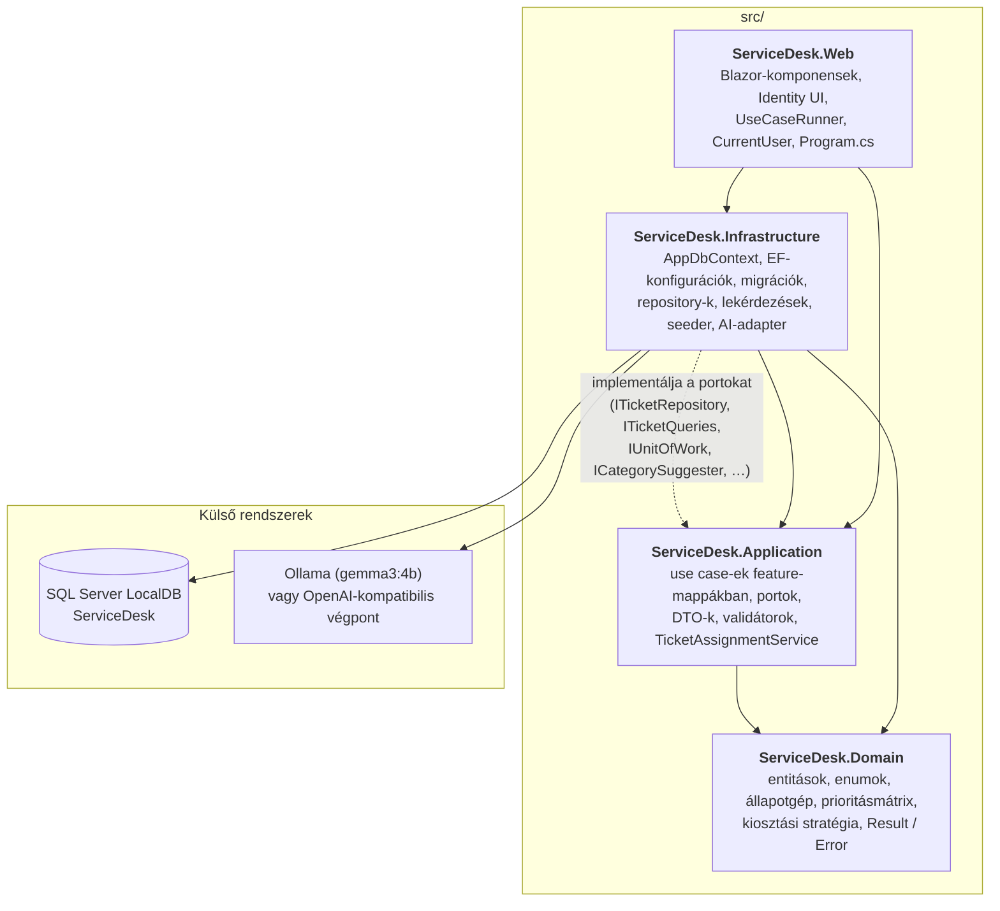
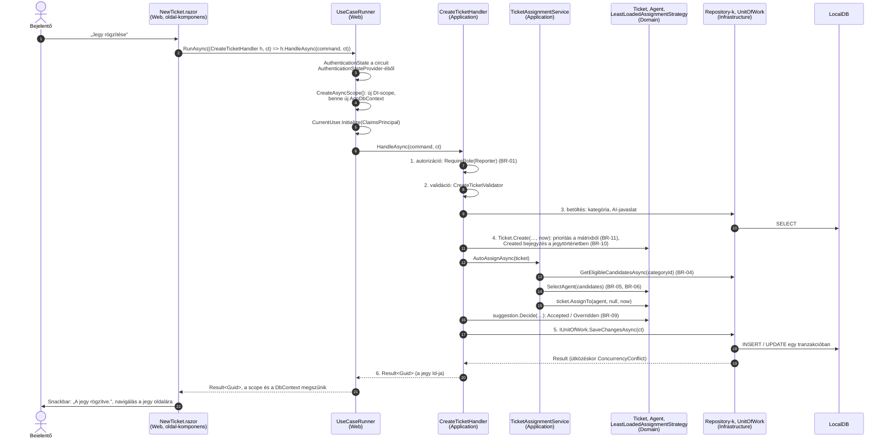
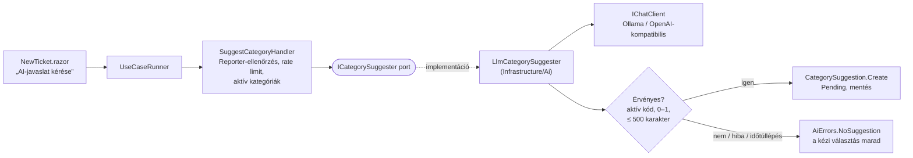
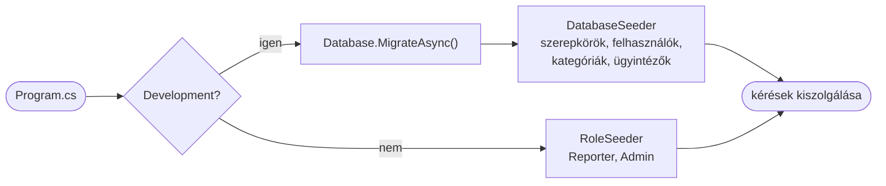

# Architektúra

A ServiceDesk egyetlen ASP.NET Core alkalmazás: Blazor Web App globális Interactive Server módban, REST API és külön
frontend nélkül ([ADR-001](adr/ADR-001-blazor-web-app-interactive-server.md)). A kód négy forrásprojektre oszlik,
befelé mutató függőségekkel ([ADR-002](adr/ADR-002-clean-architecture.md)). A szabályok forrása az
[AGENTS.md](../AGENTS.md) §4–§7.

## Rétegek és függőségek

A folytonos nyíl projekthivatkozás. A szaggatott nyíl azt jelzi, hogy az Application csak a portokat (interfészeket)
definiálja, az implementáció az Infrastructure-ben van. A DI-összerakás a `Program.cs`-ben történik
(`AddApplication`, `AddInfrastructure`, `AddUseCaseRunner`).

| Projekt | Hivatkozhat | TILOS |
|---|---|---|
| `ServiceDesk.Domain` | semmire, külső csomagra sem | minden más projekt és csomag |
| `ServiceDesk.Application` | `Domain` | EF Core, ASP.NET Core, MudBlazor, `Microsoft.Extensions.AI`, `Infrastructure`, `Web` |
| `ServiceDesk.Infrastructure` | `Application`, `Domain` | `Web` |
| `ServiceDesk.Web` | `Application`, `Infrastructure` | Infrastructure-típus a `Program.cs`-en és a `Components/Account` mappán kívül |

- A `ServiceDesk.Web.Components.Pages` névtér nem függhet az Infrastructure-tól és az EF Core-tól. Oldal-komponens
  nem injektálhat DbContextet, repositoryt vagy `UserManager`-t.
- Entitás nem hagyja el az Application réteget: a Web csak `record` DTO-t kap.
- A szabályokat a `ServiceDesk.ArchitectureTests` projekt `DependencyRuleTests` osztálya ellenőrzi NetArchTest-tel:
  - `Domain_AllTypes_DoNotDependOnOtherSolutionProjects`, `Domain_Assembly_ReferencesOnlySharedFrameworkAssemblies`;
  - `Application_AllTypes_DoNotDependOnForbiddenNamespace`;
  - `Infrastructure_AllTypes_DoNotDependOnWeb`;
  - `Web_TypesOutsideProgramAndAccount_DoNotDependOnInfrastructure`;
  - `WebPages_AllTypes_DoNotDependOnForbiddenNamespace`, `WebPages_AllTypes_DoNotDependOnForbiddenType`.

### A rétegek felelőssége

- **Domain** – gazdag modell ([ADR-004](adr/ADR-004-rich-domain-model.md)).
  - Privát setterek, létrehozás factoryval (`Ticket.Create`, `Category.Create`, `Agent.Create`), állapotváltás csak
    metóduson át (`AssignTo`, `Start`, `Resolve`, `Reopen`, `Close`, `Unassign`, `Recategorize`,
    `ChangeImpactAndUrgency`).
  - Az állapotgépet a `TicketWorkflow`, a prioritást a `PriorityMatrix`, a kiosztási döntést a
    `LeastLoadedAssignmentStrategy` írja le.
  - Szabálysértésnél `Result` / `Error` a visszatérés, nem kivétel. Nincs I/O és nincs időlekérdezés: az időpont
    `DateTimeOffset now`, a végrehajtó `string? actorUserId` paraméter.
- **Application** – use case-ek feature-mappákban (pl. `Tickets/CreateTicket/`).
  - Handlerenként egyetlen `HandleAsync` metódus, mediator nélkül.
  - Portok a perzisztenciához és az AI-hoz; a közös kiosztási logika a `TicketAssignmentService`.
  - A FluentValidation-validátorok és az autorizációs segédmetódusok (`RequireAuthenticated`, `RequireRole`) is itt
    vannak.
- **Infrastructure** – egyetlen `AppDbContext : IdentityDbContext<ApplicationUser>`, egy migrációs történettel
  ([ADR-003](adr/ADR-003-sql-server-localdb.md)).
  - Aggregátumonként egy repository, olvasásra `TicketQueries` (`AsNoTracking` + `Select` DTO-ba).
  - A `UnitOfWork` a `DbUpdateConcurrencyException`-t `GeneralErrors.ConcurrencyConflict` eredménnyé alakítja.
  - `RoleSeeder` és `DatabaseSeeder` ([ADR-009](adr/ADR-009-roles-in-every-environment.md)).
  - AI-adapter: `LlmCategorySuggester` `IChatClient`-tel, valamint a felhasználónkénti `SuggestionRateLimiter`
    ([ADR-007](adr/ADR-007-llm-provider-and-prompt-injection.md)).
- **Web** – MudBlazor-komponensek, a sablon Identity-oldalai (`Components/Account`, statikus SSR), valamint:
  - a `UseCaseRunner` és a `CurrentUser`;
  - a biztonsági fejlécek middleware-je ([ADR-008](adr/ADR-008-security-headers-csp-report-only.md));
  - a statikus státuszkód-oldalak ([ADR-006](adr/ADR-006-static-status-code-pages.md)).
  - Komponensben nincs üzleti logika: csak megjelenítés, input-gyűjtés és a `Result` kezelése.

## Egy use case útja: jegy rögzítése

Példa: egy Bejelentő a `/tickets/new` oldalon rögzít egy jegyet. Az út minden use case-nél ugyanez:
komponens → `UseCaseRunner` → handler → domain → `UnitOfWork`.

### A lépések szabályai

1. **Komponens.** Az oldal-komponens csak az `IUseCaseRunner`-t ismeri, és csak a szerepkörnek megengedett mezőket
   küldi a commandban. A `CreateTicketCommand`-ban nincs `ReporterId`, `Status`, `AssigneeAgentId` és `Priority`.
   A hosszú műveletekhez saját `CancellationTokenSource`-t használ, és ezt a `Dispose`-ban megszakítja.
2. **UseCaseRunner** ([`UseCaseRunner.cs`](../src/ServiceDesk.Web/UseCases/UseCaseRunner.cs)) – minden híváshoz:
   - lekéri a circuit hitelesítési állapotát;
   - új aszinkron DI-scope-ot nyit, és ebben inicializálja a `CurrentUser`-t;
   - a scope-ból oldja fel és futtatja a handlert.
   - Így **egy use case = egy scope = egy DbContext**; DbContext circuit-szinten nem él.
   - A `Forbidden` eredményt Warning szinten naplózza.
   - Váratlan kivételt Error szinten naplóz és továbbdob; ezt a `MainLayout` `ErrorBoundary`-je kezeli.
3. **Handler** – a sorrend kötelező:
   1. autorizáció az `ICurrentUser` alapján (`AuthErrors.Forbidden`);
   2. validáció (`Validation.<Property>` hibakódok, mezőnkénti `FieldErrors`);
   3. betöltés a repository-kból;
   4. domain-művelet;
   5. `IUnitOfWork.SaveChangesAsync`;
   6. DTO vagy azonosító visszaadása.
4. **Domain.** Az entitás metódusai érvényesítik az üzleti szabályokat, és szabálysértésnél `Error`-t adnak vissza.
   Állapotváltás csak a jegytörténet bejegyzésével együtt lehetséges (BR-10).
5. **UnitOfWork.** Az `AppDbContext.SaveChangesAsync` egy tranzakcióban menti a jegyet, a történetét, az ügyintéző
   `LastAssignedAt` értékét és a javaslat döntését. A `Ticket.RowVersion` ütközését `GeneralErrors.ConcurrencyConflict`
   eredménnyé alakítja („A jegyet időközben módosították, frissítsd az oldalt.”).
6. **Vissza a komponenshez.** A komponens a `Result`-ot kezeli:
   - siker esetén üzenet és navigáció;
   - validációs hibánál a mezőnél jelenik meg az üzenet;
   - minden más hiba `Message`-e Snackbarban jelenik meg.

### A háromszintű jogosultságkezelés helye az úton

| Szint | Hol | Példa |
|---|---|---|
| 1. UI (csak kényelmi réteg) | oldal-attribútum, menü | `@attribute [Authorize(Roles = Roles.Reporter)]`, `<AuthorizeView Roles="…">` |
| 2. Use case | a handler első lépése | `currentUser.RequireRole(Roles.Reporter)` → `AuthErrors.Forbidden` |
| 3. Erőforrás | a lekérdezés része | `TicketQueries.GetTicketDetailsAsync(ticketId, reporterId)` → idegen jegyre `null` → `TicketErrors.NotFound` (BR-02) |

## Az AI-javaslat útja

A kategóriajavaslat ugyanezen az úton fut, a `SuggestCategoryHandler` use case-szel. A domainben csak a
`CategorySuggestion` entitás érintett.

- A modell csak javasol: a kategóriát a Bejelentő választja ki („Elfogadom” vagy „Mást választok”). A döntést a jegy
  létrehozása rögzíti, ugyanabban a mentésben (BR-09).
- A prompt és a prompt-injekció elleni védelem: [docs/ai/prompt-v1.md](ai/prompt-v1.md),
  [ADR-007](adr/ADR-007-llm-provider-and-prompt-injection.md).

## Indítás és adatbázis

Az `EnsureCreated()` tiltott. A sémát mindig a `Persistence/Migrations` migrációi adják
([ADR-003](adr/ADR-003-sql-server-localdb.md), [ADR-009](adr/ADR-009-roles-in-every-environment.md)).
